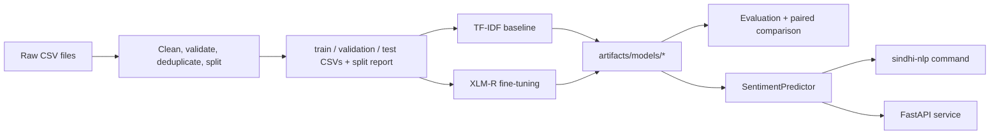

# Architecture

The project turns raw labeled text into a saved model, then serves that model through a Python SDK, a command-line tool, and an HTTP API. Every stage reads and writes plain files, so each one can be run and checked on its own.

## Stages

**1. Data preparation** (`sindhi_nlp.data`)
`load_data` reads CSVs as plain strings. `clean_data` normalizes Unicode and whitespace. `validate_data` checks the schema, labels, and duplicates. `split_data` builds seeded, stratified train/validation/test splits and keeps near-duplicates together. `prepare_external` applies the same steps to the human-labeled dataset. Each run writes a `split_report.json` (counts, seed, file hashes, cleaning settings), and two runs on the same input produce identical files.

**2. Training** (`sindhi_nlp.training`)
`baseline` trains TF-IDF + LinearSVC. `trainer` and `train` fine-tune `xlm-roberta-base` with the Hugging Face Trainer, choosing the checkpoint by validation macro-F1. Training code can only read train and validation files, never the test split. Each model folder holds the weights, tokenizer, label mapping, training configuration, seed, and metrics together.

**3. Evaluation** (`sindhi_nlp.evaluation`)
`evaluate_external` scores a saved model on a labeled split. The test split needs `--final` and refuses a second run for the same model. `compare_models` runs an exact McNemar test between two scored models, using only the saved error lists.

**4. Inference** (`sindhi_nlp.inference`)
`SentimentPredictor` loads either model type (detected from the files in the folder), applies the saved text cleaning, and returns a `Prediction` with the label, confidence, and class probabilities. Hugging Face libraries are imported only when an XLM-R model is loaded, so the baseline works with the core dependencies alone.

**5. Interfaces** (`sindhi_nlp.cli`, `sindhi_nlp.api`)
The CLI wraps the predictor for single texts and CSV batches. The FastAPI service loads the model once at startup, serializes inference with a lock, validates requests, and returns errors in one consistent format. If the model fails to load, the service stays up and reports the problem on `/health`.

## Reproducibility rules

- Never modify `data/raw/` after placing source data there.
- Repeatable work lives in `src/`; notebooks are for exploration only.
- Choose settings on validation data. The test split is scored once per model.
- Save the model, tokenizer, label mapping, configuration, metrics, and seed together.
- Do not commit datasets, model weights, API keys, or `.env` files.

## Folders

| Path | Contents | In Git |
| --- | --- | --- |
| `configs/` | YAML settings | yes |
| `src/`, `tests/`, `docs/` | code, tests, documentation | yes |
| `data/raw`, `data/interim`, `data/processed`, `data/external` | datasets and splits | no (only small reports) |
| `artifacts/models` | trained models | no |
| `artifacts/metrics`, `artifacts/reports` | metrics and summaries | summaries and metrics JSON only |
