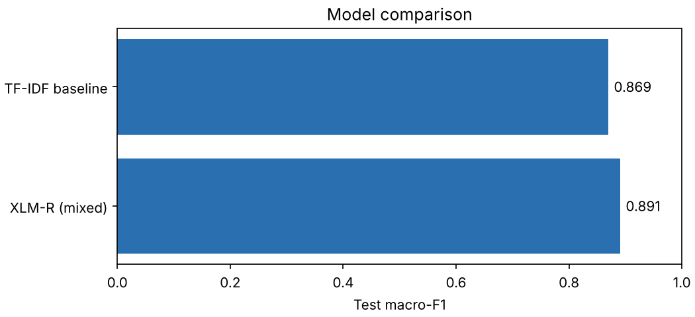
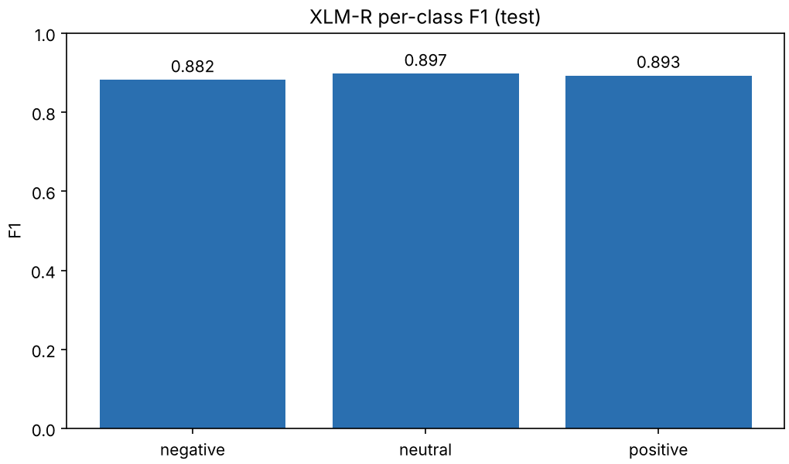
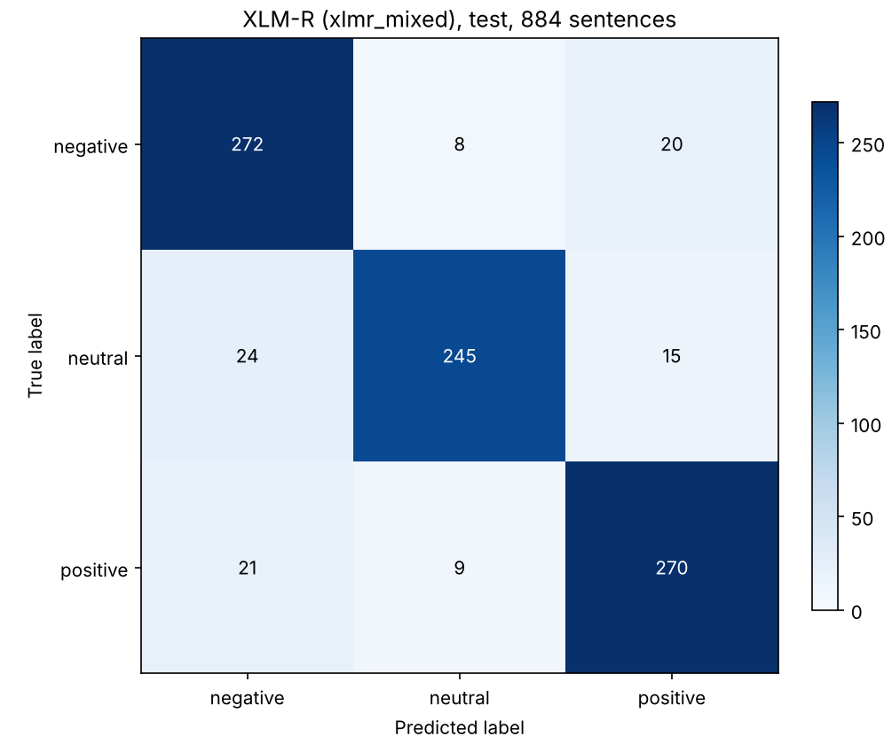

# Results

All numbers are on the human-labeled dataset of 4,420 sentences (3,094 train / 442 validation / 884 test). Test results were produced once per model, after every choice was fixed. Raw files are in [`artifacts/metrics/`](https://github.com/alinawazcode/sindhi-nlp/tree/main/artifacts/metrics).

## Headline

| Model | Trained on | Validation macro-F1 | Test macro-F1 | Test accuracy |
| --- | --- | ---: | ---: | ---: |
| TF-IDF + LinearSVC | synthetic data only | 0.6002 | not run | not run |
| TF-IDF + LinearSVC (`baseline_natural`) | human-labeled | 0.8665 | 0.8695 | 0.8688 |
| XLM-RoBERTa base | human-labeled | 0.8663 | not run | not run |
| **XLM-RoBERTa base (`xlmr_mixed`)** | up to 30,000 synthetic + human-labeled (x5) | **0.8872** | **0.8906** | **0.8903** |



## Is XLM-R really better?

Not demonstrably. On the 884 test sentences both models were right on 712 and wrong on 41. The baseline alone was wrong on 75, XLM-R alone on 56. The exact McNemar test gives **p = 0.1155**.

| | Accuracy | 95% interval |
| --- | ---: | --- |
| `baseline_natural` | 0.8688 | 0.845 to 0.889 |
| `xlmr_mixed` | 0.8903 | 0.868 to 0.909 |

The intervals overlap heavily. See [Evaluation method](concepts/evaluation-method.md).

## Per class (test)

| Class | XLM-R precision | recall | F1 | Baseline precision | recall | F1 | Support |
| --- | ---: | ---: | ---: | ---: | ---: | ---: | ---: |
| negative | 0.858 | 0.907 | 0.882 | 0.853 | 0.853 | 0.853 | 300 |
| neutral | 0.935 | 0.863 | 0.897 | 0.912 | 0.880 | 0.896 | 284 |
| positive | 0.885 | 0.900 | 0.893 | 0.845 | 0.873 | 0.859 | 300 |



## Where the mistakes are

Confusion matrices (rows = true class, columns = predicted class):




- XLM-R's mistakes are spread fairly evenly: 24 neutral sentences predicted negative, 21 positive predicted negative, 20 negative predicted positive, 15 neutral predicted positive, 9 positive predicted neutral and 8 negative predicted neutral.
- The baseline's largest single confusion is 35 negative sentences predicted positive.
- XLM-R's neutral predictions are the most precise (0.935) but its neutral recall is the lowest of its three classes (0.863): when it says neutral it is usually right, but it misses some neutral sentences.

## What the synthetic data did

| Experiment | Validation macro-F1 |
| --- | ---: |
| baseline trained on synthetic only, scored on human-labeled data | 0.6002 |
| baseline trained on synthetic only, scored on synthetic data | 0.9998 |
| XLM-R on human-labeled data only | 0.8663 |
| XLM-R on human-labeled + synthetic | 0.8872 |

Templated data teaches little about real text. Adding it raised XLM-R's validation score by about 0.02, a gap that was not tested for significance.

## Reproduce

```bash
python -m sindhi_nlp.evaluation.evaluate_external --model-dir artifacts/models/xlmr_mixed --split validation
python -m sindhi_nlp.evaluation.evaluate_external --model-dir artifacts/models/xlmr_mixed --split test --final
python -m sindhi_nlp.evaluation.compare_models --a baseline_natural --b xlmr_mixed --split test
```

This needs the splits and model folders (not stored in Git); the [reproduction steps](tutorials/train-own-data.md) and the [dataset page](dataset.md) explain how to obtain them. The figures above were generated from the saved metrics files with `sindhi_nlp.evaluation.plots`.
